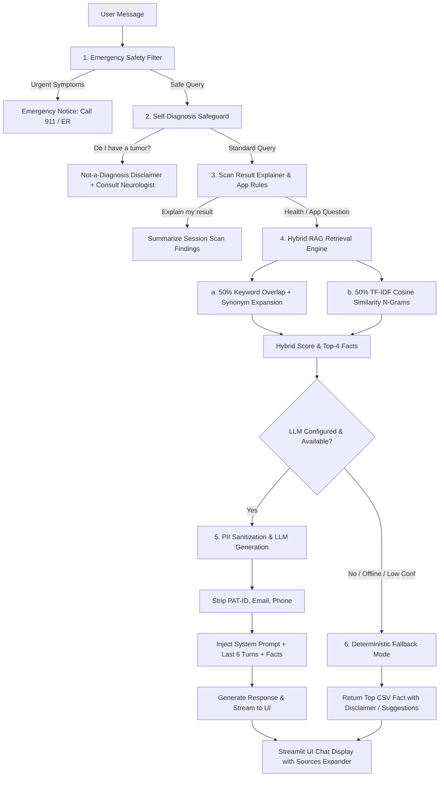

# 🧠 Mastishka AI Medical Assistant Module

**Mastishka** (*Hindi for brain*) is a ChatGPT-style conversational medical assistant built into **NeuroScan AI**. It combines **Hybrid RAG** (Keyword overlap + TF-IDF cosine similarity over NCI/NINDS datasets), **Context-Aware Chat History**, **Provider-Agnostic LLM Generation** (OpenAI, Gemini, Anthropic, Ollama), **Patient Privacy (PII Sanitization)**, and **Graceful Offline Fallback**.

---

## 🏗️ Architecture & Data Flow



---

## ⚙️ Provider Selection & Environment Setup

Configure Mastishka in `.env` using any supported LLM provider:

```ini
# Provider options: openai | gemini | anthropic | ollama | (empty for offline fallback)
LLM_PROVIDER=gemini
LLM_API_KEY=your_api_key_here
LLM_MODEL=gemini-1.5-flash
LLM_TIMEOUT=20
RETRIEVAL_THRESHOLD=0.25
```

### 1. OpenAI
```ini
LLM_PROVIDER=openai
LLM_API_KEY=sk-...
LLM_MODEL=gpt-3.5-turbo  # or gpt-4o
```

### 2. Google Gemini
```ini
LLM_PROVIDER=gemini
LLM_API_KEY=AIzaSy...
LLM_MODEL=gemini-1.5-flash
```

### 3. Anthropic Claude
```ini
LLM_PROVIDER=anthropic
LLM_API_KEY=sk-ant-...
LLM_MODEL=claude-3-haiku-20240307
```

### 4. Free & Local with Ollama 🦙
To run Mastishka 100% locally and free without external APIs:

1. Install [Ollama](https://ollama.com/) and pull a model:
   ```bash
   ollama pull llama3
   ```
2. Configure `.env`:
   ```ini
   LLM_PROVIDER=ollama
   LLM_MODEL=llama3
   OLLAMA_HOST=http://localhost:11434
   ```

### 5. Pure Offline Mode (No LLM Required)
Set `LLM_PROVIDER=` (empty). Mastishka will operate deterministically using local hybrid CSV retrieval.

---

## 📁 Data Files

Located in `chatbot/data/`:
- `brain_tumor_chatbot_dataset2.csv` (300 rows, 100 intents, paraphrased questions)
- `brain_tumor_chatbot_dataset_100.csv` (100 rows, 100 intents, canonical answers)
- `knowledge_base.csv` & `knowledge_base.json` (Canonical merged & deduplicated knowledge base)

---

## 🛠️ How to Add New Q&A Rows & Rebuild

To expand Mastishka's knowledge base:

1. Open `chatbot/data/brain_tumor_chatbot_dataset2.csv` or `brain_tumor_chatbot_dataset_100.csv`.
2. Add new row(s) following the CSV format:
   ```csv
   id,question,answer,intent,category,source
   ```
3. Rebuild and validate the knowledge base:
   ```bash
   python chatbot/build_knowledge_base.py
   ```

---

## 🧪 Testing

Run tests via `pytest`:

```bash
python -m pytest tests/test_chatbot.py
```

Tests cover:
- Knowledge base integrity (0 null/empty cells, unique IDs, bug fix validation).
- Hybrid retrieval self-match accuracy ($\ge 95\%$).
- 25 hand-written keyword queries retrieval accuracy ($\ge 84\%$).
- Mocked LLM path with PII sanitization (stripping patient IDs, emails, phone numbers).
- Offline fallback path without API key.
- Emergency & self-diagnosis safety protocols.
- Contextual follow-up history handling.
